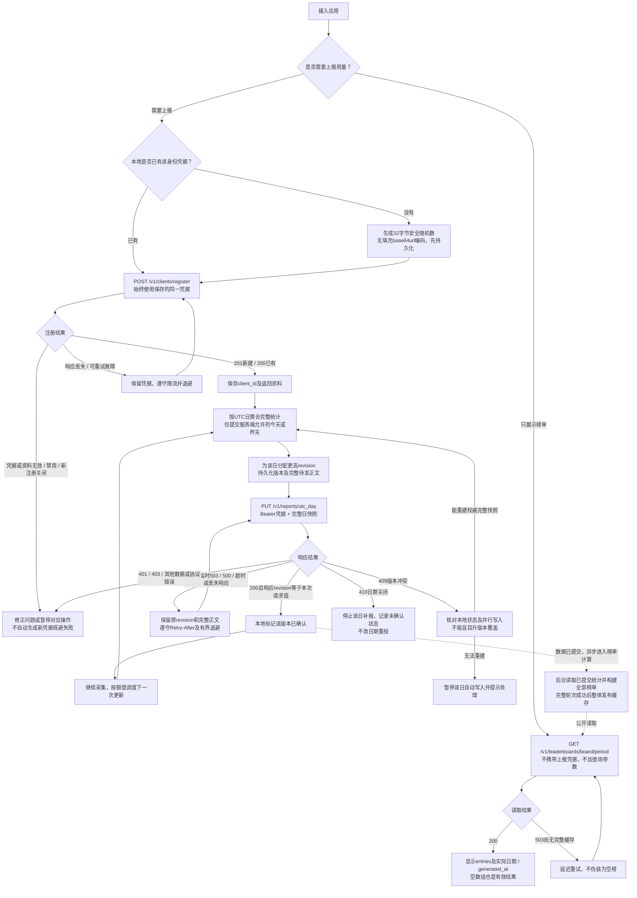
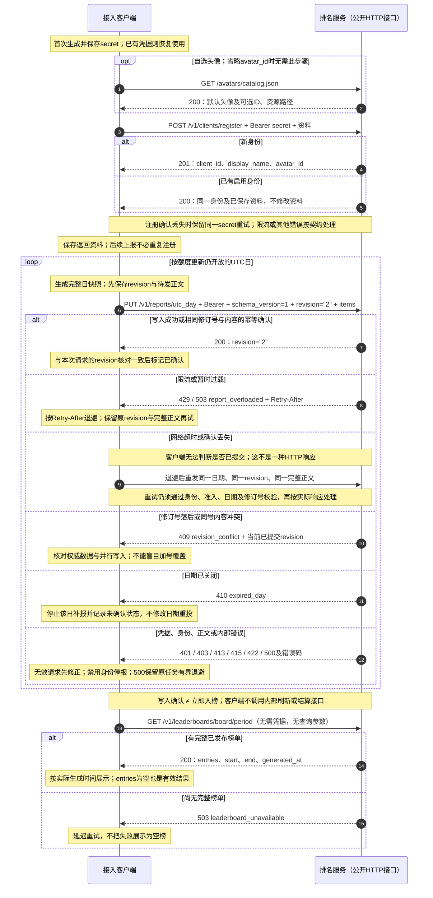
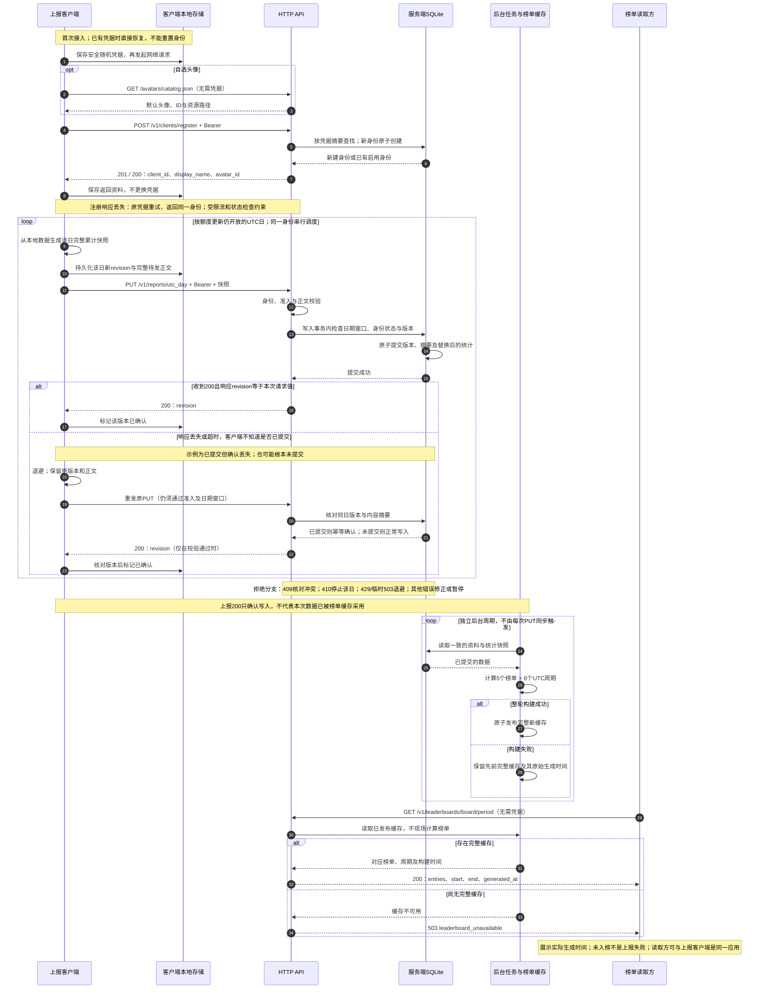

# 接入流程与时序

本图适用于任意接入客户端，与具体采集器、数据库或SDK无关。接口字段、限流和错误码详见[客户端接入指南](integration.md)。图中的客户端本地存储由接入方实现，不是服务端提供的接口。

## 1. 整体流程

- 注册只在首次接入或需要恢复身份时执行，不必在每次上报前注册。
- 头像选择为可选步骤：注册前读取 `/avatars/catalog.json`；省略 `avatar_id` 使用默认头像。
- 重试不绕过限流、禁用状态或日期窗口。暂时采集失败不能用 `items: []` 占位；它会清空该日已匹配统计。
- `409`返回当前服务端版本，但没有读取已提交快照正文的接口；不能只修改版本号来抢写。

## 2. 对外时序：客户端与排名服务

此图把排名服务视为一个整体，不暴露数据库或缓存组件。上报客户端与榜单读取方可以是同一应用；仅展示榜单时直接执行最后的GET即可。

`revision` 是该身份该UTC日的**数据修订号**，没有主/次版本，也不是软件发布版本。响应确认的是本次请求携带的修订号。兼容软件升级继续使用 `/v1` 与 `schema_version: 1`，保留身份与修订状态，详见[概念区分](integration.md#数据修订号确认与更正)。

`/healthz`、`/readyz` 可用于独立监控，不要求客户端在每次业务请求前先调用，也不能替代注册或上报确认。

## 3. 内部时序：服务端处理与异步榜单构建

保留客户端作为触发方，并展开本地持久化、HTTP处理、数据库和后台缓存；这些内部步骤不是要求接入方调用的新接口。

## 4. 时间与成功判定

| 阶段 | 完成标志 | 不代表什么 |
|---|---|---|
| 本地准备 | 凭据、待发版本及正文已可靠保存 | 服务器尚未确认接收 |
| 身份注册 | 收到201或200并保存返回身份 | 不代表已提交任何用量 |
| 日快照确认 | 收到200且响应 `revision` 与本次请求的值数值一致 | 不代表已刷新榜单或一定进入前100 |
| 榜单发布 | 后台完整轮次构建成功并发布 | 不保证包含轮次读取之后的提交 |
| 榜单读取 | 收到200及实际边界、`generated_at` | 不保证数据绝对新鲜；可能保留旧轮次 |

- 默认榜单构建周期为5分钟，可由部署者调整；这不是“上报后最多5分钟可见”的承诺，构建时间和失败都会影响可见性。
- `week` / `month` 分别读取上一完整UTC自然周（周一开始）/自然月；周一或月初的昨天仍可在日报窗口内修订，成功的后续缓存轮次才反映修订。
- 日界使用UTC。某日关闭后，不再接受该日重试或更正；后台日结将其统计归入周、月及累计数据。这是服务内部维护，不需要客户端调用“结算”接口。
- 后台日结与缓存构建独立调度，并不是每个PUT后顺序执行的两个步骤。
- `/healthz`仅检查存活；`/readyz`检查数据库、目录及初始缓存就绪，均不是某次上报的确认接口。
